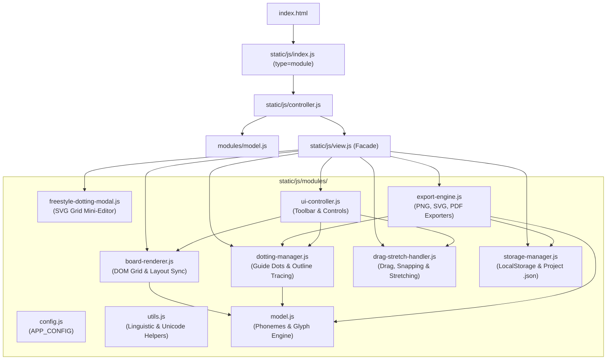
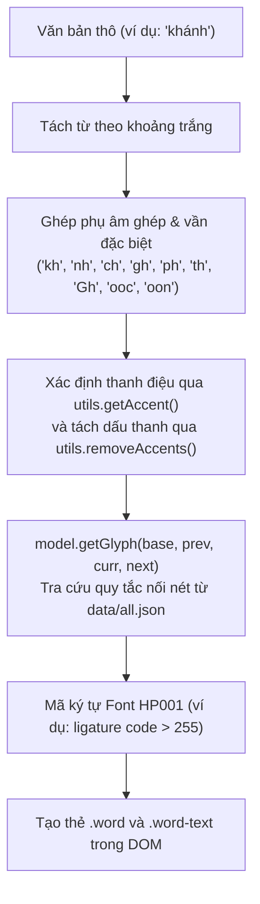

# Vietnamese Handwriting Generator — Architecture & Developer Guide

Tài liệu thiết kế kiến trúc kỹ thuật dành cho **AI Agents** và **nhà phát triển** tham gia bảo trì, tối ưu và mở rộng hệ thống `VietnameseHandwritingGenerator`.

---

## 1. Tổng quan Hệ thống (System Overview)

`VietnameseHandwritingGenerator` là ứng dụng web tương tác chạy trên trình duyệt phục vụ giáo viên, phụ huynh và học sinh tiểu học:
- Tạo mẫu chữ viết ô ly tiểu học chuẩn font **HP001** (HP001 3.0 của Nhà in HP).
- Hỗ trợ các loại bố cục: **Bảng đen phấn trắng vô cực**, **Vở ô ly trắng (chuẩn & trang vở 11x14, 14x20)**, và **Bảng con tiểu học (Blackboard slate)**.
- Tạo mẫu chấm đặt bút hướng dẫn (chấm mẫu chuẩn theo nét chữ và chấm tự do trên ô ly SVG).
- Xuất tài liệu đa định dạng độ nét cao: **PNG (Ultra HD 4x/8x)**, **Vector SVG (vô cực không vỡ nét)**, và **PDF in ấn A4**.

### Nguyên lý thiết kế cốt lõi
1. **Zero-Build Architecture**: Ứng dụng chạy mã nguồn chuẩn **Native ES Modules** (`<script type="module">`). Không cần Webpack, Vite hay bước biên dịch `npm build`. Nginx phục vụ trực tiếp các file tĩnh (`.js`, `.css`, `.ttf`, `.otf`, `.svg`, `.json`).
2. **Physical Geometry Invariants**: Các quy tắc hình học (chiều cao dòng, chu kỳ vân lưới 384px, căn giữa đường kẻ 1.5px) là bất biến vật lý và được bảo vệ nghiêm ngặt.
3. **Decoupled Single-Responsibility Subsystems**: Mã nguồn được chia thành các module chức năng độc lập đặt tại `static/js/modules/`, liên kết qua facade `static/js/view.js` và `static/js/controller.js`.

---

## 2. Sơ đồ Cấu trúc Module (Module Topology)



### Danh mục Module và Trách nhiệm:

| Module File | Export chính | Trách nhiệm |
| :--- | :--- | :--- |
| `static/js/modules/config.js` | `APP_CONFIG` | Tham số cấu hình toàn cục: ngưỡng giãn chữ chuẩn (121.89%), giới hạn kéo từ quá đầu dòng (28.35px). |
| `static/js/modules/utils.js` | `utils` | Xử lý chuỗi tiếng Việt: tách dấu thanh (`getAccent`), chuyển chữ hoa (`isUpperCase`), tách dấu thanh giữ nguyên nguyên âm gốc (`removeAccents`), lọc HTML (`stripHtml`). |
| `static/js/modules/model.js` | `model` | Nạp `/data/all.json`, tra cứu phụ âm ghép, quy tắc nối nét ngữ cảnh (`getGlyph`), điểm bắt đầu (`defaultStartPoints`), cấu hình chấm mẫu (`getGlyphDotConfigs`). |
| `static/js/modules/board-renderer.js` | `boardRenderer` | Điều phối render văn bản ra DOM: đồng bộ bảng đen (`syncBlackboards`), bảng trắng trang vở (`syncWhite11x14`, `syncWhite14x20`), bảng vô cực (`syncNormalBoard`), tạo các thẻ `<p class="line">` và `<span class="word">`. |
| `static/js/modules/dotting-manager.js` | `dottingManager` | Tính toán bước cách ô (`calculateAutoSpaces`), hiển thị chấm mẫu hướng dẫn đặt bút (`renderDotsForLine`), chữ mờ tập tô (`parseOutlineOption`). |
| `static/js/modules/drag-stretch-handler.js` | `dragStretchHandler` | Xử lý tương tác kéo thả từ chuột/cảm ứng (`btn-word-drag`), kéo giãn chiều ngang (`btn-word-stretch`), bật/tắt đậm từng từ (`btn-word-bold`), mở popover cài đặt nhanh. |
| `static/js/modules/freestyle-dotting-modal.js` | `freestyleDottingModal` | Hộp thoại chỉnh sửa chấm tự do tương tác: lưới SVG ô ly 56px, kéo thả điểm chấm, bắt dính 0.25 ô ly (`snap`), áp dụng theo từ hoặc toàn bộ văn bản. |
| `static/js/modules/storage-manager.js` | `storageManager` | Tự động lưu bản nháp vào LocalStorage (`chudep_workspace_draft`), phát hiện và khôi phục nháp, xuất/nạp tệp dự án định dạng `.json`. |
| `static/js/modules/export-engine.js` | `exportEngine` | Bộ máy xuất tệp chất lượng cao: Canvas PNG đa độ phân giải (2x/4x/6x/8x), SVG nhúng base64 font HP001, và tài liệu PDF khổ in A4 qua jsPDF. |
| `static/js/modules/ui-controller.js` | `uiController` | Lắng nghe sự kiện thanh công cụ: chọn cỡ chữ, đổi màu bảng, chọn bài mẫu, tải font, bật tự động giãn chữ. |
| `static/js/view.js` | `view` | Mặt tiền (Facade) tích hợp toàn bộ các module, duy trì cầu nối tương thích ngược `window.view = view` cho các sự kiện DOM inline (`onclick="view.exportFile()"`). |
| `static/js/controller.js` | `controller` | Khởi tạo ứng dụng, kiểm tra chế độ debug (`?debug`), kích hoạt nạp dữ liệu và kiểm tra bản nháp chưa lưu. |

---

## 3. Đường ống Xử lý Ký tự & Font HP001 (Glyph Pipeline)

Phông chữ tập viết **HP001** không dùng bảng mã Unicode chuẩn cho mọi ký tự nối; phông chứa hàng trăm glyph nối nét riêng biệt (ligature) cho từng cặp nguyên âm và phụ âm đứng trước/sau.



### Chi tiết các bước:
1. **Phụ âm ghép (Compound Consonants)**:
   Các cụm phụ âm `kh, nh, ch, gh, ph, th, Gh` được gom thành 1 đơn vị âm học (char unit) duy nhất để tra cứu quy tắc nối nét ban đầu.
2. **Vần đặc biệt (Special Ligatures)**:
   Các tổ hợp nguyên âm đôi/ba như `ooc, oóc, oọc, oon, oón, oòn` được xử lý nguyên khối để chọn đúng glyph mở rộng trong font.
3. **Thanh điệu tiếng Việt (Vietnamese Tones)**:
   Hệ thống phân tách thanh điệu thành 6 loại:
   - `level` (thanh ngang / không dấu)
   - `acute` (thanh sắc: *á, ắ, ấ, ó, ...*)
   - `lower` (thanh huyền: *à, ằ, ầ, ò, ...*)
   - `rising` (thanh hỏi: *ả, ẳ, ẩ, ỏ, ...*)
   - `raised` (thanh ngã: *ã, ẵ, ẫ, õ, ...*)
   - `heavy` (thanh nặng: *ạ, ặ, ậ, ọ, ...*)
4. **Quy tắc nối ngữ cảnh**:
   `all.json` chứa cấu trúc:
   ```json
   "h": {
     "types": [
       {
         "isCap": false,
         "prev": ["a", "c", "o", null],
         "next": ["a", "e", "i", null],
         "accent": {
           "level": "104",
           "acute": "205"
         }
       }
     ]
   }
   ```
   Nếu `char` đứng sau `prev` và trước `next`, mã glyph tương ứng trong trường `accent` sẽ được chọn để hiển thị chuẩn xác nét nối giữa 2 chữ cái.

---

## 4. Các Bất Biến Vật Lý & Hình Học (Physical Layout Invariants)

Các bất biến sau đây bắt buộc **KHÔNG ĐƯỢC TỰ Ý THAY ĐỔI** để tránh gây lỗi lệch dòng hoặc trôi lưới trên các trình duyệt Chrome, Firefox, Safari:

### 4.1. Chu kỳ Vân Lưới 384px (384px Integer-Period Tiling)
- **Vấn đề**: Kích thước 1 ô vuông lớn chuẩn tập viết là $19.2\text{px} \times 4 = 76.8\text{px}$. Số $76.8$ là số thực không nguyên. Khi GPU rasterizer (Skia trên Chrome, WebRender trên Firefox, CoreGraphics trên Safari) lặp nền `background-image` với bước $76.8\text{px}$, các trình duyệt sẽ làm tròn lên $77\text{px}$, tích lũy sai số $+0.4\text{px}$ mỗi dòng ($+8\text{px}$ sau 20 dòng), làm chữ rơi dần ra khỏi dòng kẻ.
- **Giải pháp bất biến**: Chu kỳ lặp dọc của nền lưới luôn đặt là **$384\text{px}$** ($19.2\text{px} \times 20 = 384.0\text{px}$, tương đương 5 khối = 20 ô ly). $384\text{px}$ là số nguyên chính xác trên mọi tỷ lệ màn hình (1x: 384px, 1.25x: 480px, 1.5x: 576px, 2x: 768px), triệt tiêu hoàn toàn hiện tượng trôi lưới trên vô số dòng.

### 4.2. Khống chế Chiều cao Dòng (Rigid Line Height Capping)
- Các dòng văn bản `#result, .result-text` sử dụng CSS Grid:
  - 72pt (cỡ 2 ô ly): `grid-auto-rows: calc(var(--grid-unit) * 8);` (153.6px)
  - 37pt (cỡ 1 ô ly): `grid-auto-rows: calc(var(--grid-unit) * 4);` (76.8px)
- Phần tử `<p class="line">` bắt buộc phải có:
  ```css
  height: calc(var(--grid-unit) * 8) !important;
  max-height: calc(var(--grid-unit) * 8) !important;
  min-height: 0 !important;
  box-sizing: border-box;
  margin: 0;
  padding: 0;
  ```
  `min-height: 0 !important` ngăn trình duyệt áp dụng `min-height: auto` của CSS Grid items khi các dấu mũ tiếng Việt rất cao (như dấu ngã trên chữ ẫ, ẵ) có nguy cơ đẩy bung chiều cao dòng track.

### 4.3. Căn Giữa Tâm Đường Kẻ (Guideline Centering Invariant)
- Đáy của thân chữ cái (baseline) phải nằm chính giữa độ dày của đường kẻ đậm 1.5px (không lệch lên trên hoặc xuống dưới mép nét kẻ). Container `padding-top` đã được cân chỉnh chuẩn xác qua:
  - Bảng vô cực: `calc(var(--grid-unit) * 0.7 - 1.25px)` (72pt) và `calc(var(--grid-unit) * 3.32 - 0.4px)` (37pt).
  - Vở 11x14 & 14x20: `calc(var(--grid-unit) * 0.2 + 8.75px)` (72pt) và `calc(var(--grid-unit) * 3.34 - 0.4px)` (37pt).

### 4.4. Kiến trúc Bảng Con (Blackboard Slate Architecture)
- Bảng con `.board.blackboard` **KHÔNG** dùng CSS Grid đa dòng. Nó kết xuất 1 dòng văn bản duy nhất neo cố định trên Đường kẻ 1 ($y = 408.05\text{px}$) bên trong khung vector SVG $842\text{px} \times 595\text{px}$.
- Phải luôn duy trì:
  ```css
  .board.blackboard #result,
  .board.blackboard .result-text {
      display: block !important;
      position: absolute !important;
      left: 96.09px !important;
      line-height: 1 !important;
      height: auto !important;
      min-width: 0 !important;
  }
  ```
  **Tuyệt đối không áp dụng giới hạn dòng CSS Grid (76.8px hay 153.6px) lên `.board.blackboard`**, vì sẽ tạo negative half-leading làm chữ vọt lên trên đường kẻ từ 34px đến 68px.

### 4.5. Thông số Xuất Trang Vở 11x14 & 14x20 (Export Thickness Constants)
Trong `static/js/modules/export-engine.js`:
- Kích thước trang:
  - Vở 11x14: 11 khối x 14 khối = 883.2px x 1152px (7 dòng 72pt, 14 dòng 37pt).
  - Vở 14x20: 14 khối x 20 khối = 1113.6px x 1612.8px (10 dòng 72pt, 20 dòng 37pt).
- Độ dày đường kẻ khi xuất file:
  - Vở 11x14: `gridLineWidthMajor = 1.4;`, `gridLineWidthMinor = 0.7;`.
  - Vở 14x20: `gridLineWidthMajor = 1.82;`, `gridLineWidthMinor = 0.91;` (dày hơn 30% khi xuất).
- `majorColor = 'rgba(60, 75, 115, 0.9)'`, `minorColor = 'rgba(90, 115, 165, 0.7)'`.
- `dotRadius = isSmall ? 1.25 : 1.75;` (bán kính chấm mẫu xuất file).

---

## 5. Cơ chế Giãn Chữ Chuẩn 121.89% (Word Stretch Mechanics)

Trong font HP001 (`HP001N30.ttf`), ký tự `'o'` thường (`glyph00088`) có kích thước bounding box là **676 đơn vị rộng** và **824 đơn vị cao**.
- Ở chế độ 1 ô ly, chiều cao 824 vừa vặn chạm mép trên và mép dưới của 1 ô vuông ô ly.
- Để chiều rộng của `'o'` cũng vừa khít chạm 2 cạnh trái và phải của ô vuông ($W = H = 824$), tỷ lệ giãn ngang cần thiết là:
  $$\text{Stretch Ratio} = \frac{824}{676} \approx 1.218935 \quad (121.89\%)$$
- Khi bật tính năng **"Tự động giãn chữ"** (`#autostretch-checkbox`), hệ thống tự động áp dụng `scaleX(1.2189)` cho tất cả các từ chưa được người dùng can thiệp thủ công.
- Khi người dùng kéo dãn bằng handle `.btn-word-stretch`, hệ thống tự động bắt dính (`snap`) vào $121.89\%$ nếu khoảng cách kéo nằm trong dung sai $\pm 2.5\%$.

---

## 6. Cấu trúc Tệp Dự Án (`.json`) & LocalStorage Draft

Tệp bài tập được xuất ra dưới dạng JSON (`chudep_{tên-bài}_{thời-gian}.json`) với cấu trúc chuẩn:

```json
{
  "app": "VietnameseHandwritingGenerator",
  "version": 1,
  "savedAt": "2026-10-25T12:00:00.000Z",
  "text": "Nét chữ nết người",
  "sampleSelect": "sample1",
  "settings": {
    "fontSize": "72",
    "boardColor": "black",
    "fontColor": "#ffffff",
    "weight": true,
    "style": false,
    "autoStretch": false
  },
  "dotting": {
    "enabled": true,
    "spaces": 2,
    "repetitions": 5,
    "linesCount": 1,
    "fullDot": true,
    "outline": "none",
    "color": "#e53935",
    "lineDotConfigs": {},
    "wordDotConfigs": {
      "0_0": {
        "customDots": [{ "x": 0.65, "y": 1.75, "label": "Đặt bút" }],
        "dotConfigId": "dynamic"
      }
    }
  },
  "wordLayout": {
    "0": {
      "0": {
        "marginLeft": "12px",
        "stretch": 1.2189,
        "naturalWidth": 142.5,
        "weight": "bold",
        "manualStretch": true
      }
    }
  }
}
```

LocalStorage lưu 2 key song song để bảo đảm tính tương thích:
- `chudep_workspace_draft`
- `handwriting_workspace_draft_v1`

---

## 7. Quy trình Kiểm thử & Xác minh (Verification Suite)

Mọi thay đổi trên mã nguồn phải được kiểm tra qua bộ test tự động:

```bash
npm test
# hoặc
node tests/verify-refactor.js
```

Bộ test tự động thực hiện 54 tiêu chí kiểm tra:
1. **Module & Interface Check**: Kiểm tra cú pháp ES Module và các hàm xuất khẩu của toàn bộ 10 file trong `static/js/modules/`.
2. **Linguistic Engine Check**: Chạy toàn bộ 6,782 âm tiết tiếng Việt từ `data/test.txt` qua `model.getUnicodeStr()`, kiểm tra phụ âm ghép và mã ligature.
3. **Physical Geometry Check**: Quét file `static/css/board.css` để bảo đảm không vi phạm chu kỳ 384px, rigid line height, và Blackboard anchoring.
4. **Live Docker Service Check**: Kiểm tra HTTP 200 và MIME `application/javascript` trên container `chudep` đang chạy tại `http://127.0.0.1:8080`.

---

## 8. Hướng dẫn Dành cho AI Agents Khi Mở rộng Tính năng

Khi nhận yêu cầu thêm tính năng mới:
1. **Không gộp code vào `view.js`**: Thêm logic vào module chuyên trách tương ứng trong `static/js/modules/` (hoặc tạo module mới nếu là một hệ thống con độc lập).
2. **Khai báo Facade**: Nếu tính năng cần gọi từ các nút bấm HTML hoặc các module khác, hãy xuất hàm qua `export` của module đó và gắn vào đối tượng `view` trong `static/js/view.js`.
3. **Bảo tồn Invariants**: Đọc kỹ phần 4 trước khi sửa bất kỳ dòng CSS nào liên quan đến `.board`, `#result`, `.grid`, `.line`, hoặc `.word`.
4. **Xác minh trước khi kết luận**: Luôn chạy `npm test` và kiểm tra phản hồi HTTP từ `127.0.0.1:8080`.
