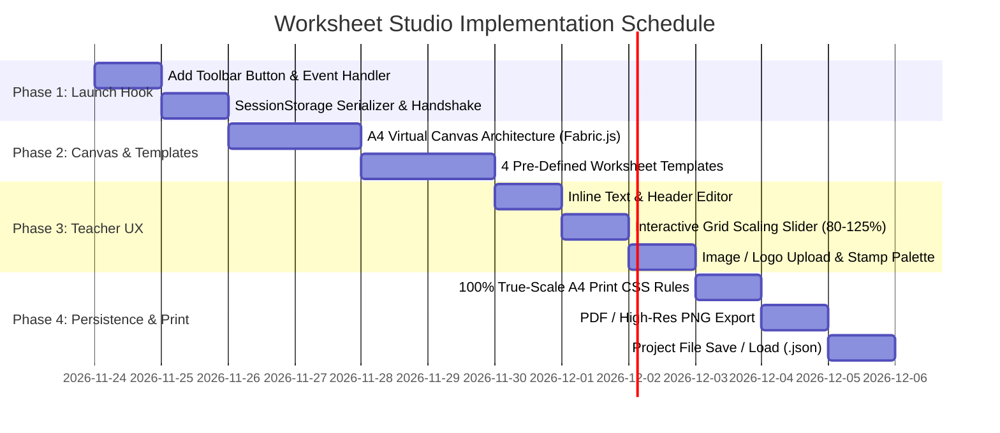

# Architecture & Implementation Plan: A4 Worksheet Studio & Primary School Practice Sheet Integration

> **Document Version:** 1.0.0  
> **Target Release:** v1.2.0  
> **Status:** Approved Proposal / Ready for Implementation  

---

## 1. Overview & Objective

This document outlines the architectural specification and implementation roadmap for **Worksheet Studio** — an integrated, lightweight, and self-hosted A4 worksheet designer for the Vietnamese Handwriting Generator.

It bridges the gap between raw handwriting grid generation (14x20 and 11x14 notebook layouts) and completed, print-ready primary school practice sheets (`Phiếu bài tập luyện viết chữ đẹp`) without forcing teachers into error-prone external tools like Microsoft Word or PowerPoint.

---

## 2. System Architecture & Component Diagram

```
┌────────────────────────────────────────────────────────────────────────┐
│                   MAIN HANDWRITING APPLICATION                         │
│                    (index.html / chudep:8080)                          │
│                                                                        │
│   [Text Input] ──> [Board Renderer] ──> [14x20 / 11x14 Board]          │
│                                                   │                    │
│                                      [Click "Thiết kế phiếu A4"]       │
│                                                   ▼                    │
│                                   [Serialize Board SVG & Metadata]     │
│                                                   │                    │
│                                    sessionStorage.setItem(...)         │
└───────────────────────────────────────────────────┼────────────────────┘
                                                    │ window.open('/worksheet.html')
                                                    ▼
┌────────────────────────────────────────────────────────────────────────┐
│                      A4 WORKSHEET STUDIO SUB-APP                       │
│                     (worksheet.html / chudep:8080)                     │
│                                                                        │
│   ┌────────────────────────────────────────────────────────────────┐   │
│   │                      TOP ACTION TOOLBAR                        │   │
│   │ [Mẫu phiếu ▼] [Thêm chữ] [Thêm ảnh] [Giãn lưới: 100% ━●━]    │   │
│   │               [Lưu mẫu .json] [Mở mẫu] [In ngay] [Xuất PDF]    │   │
│   └────────────────────────────────────────────────────────────────┘   │
│                                                                        │
│   ┌────────────────────────────────────────────────────────────────┐   │
│   │                 A4 VIRTUAL WORKSPACE (210mm x 297mm)           │   │
│   │                                                                │   │
│   │   [Header]: Trường Tiểu học... | Lớp... | Họ và tên...         │   │
│   │   [Title]:  BÀI LUYỆN VIẾT SỐ 1                                │   │
│   │   [Grid]:   Embedded 14x20 SVG (calibrated to exact 1cm cells) │   │
│   │   [Footer]: Khung điểm & Nhận xét của giáo viên                │   │
│   │                                                                │   │
│   └────────────────────────────────────────────────────────────────┘   │
└────────────────────────────────────────────────────────────────────────┘
```

---

## 3. Dimensional Calibration & Exact Physical Scaling

### 3.1. Standard Vietnamese Notebook Ruling
- In primary school notebooks (Vở 4 ô ly / 5 ô ly chuẩn Bộ GD&ĐT):
  - **1 small ô ly (sub-cell):** Exactly **$2.5\text{ mm} \times 2.5\text{ mm}$**.
  - **1 big block (4 ô ly con):** Exactly **$10\text{ mm} \times 10\text{ mm}$** ($1.0\text{ cm} \times 1.0\text{ cm}$).

### 3.2. Digital Coordinate Mapping
- **Input SVG metrics:**
  - 1 sub-cell = $19.2\text{ px}$ ($14.4\text{ pt} \times \frac{96}{72}$).
  - 1 big block = $4 \times 19.2\text{ px} = 76.8\text{ px}$.
- **A4 Physical Constants ($96\text{ DPI}$ standard):**
  - $1\text{ mm} = \frac{96}{25.4} \approx 3.779528\text{ px}$.
  - $10\text{ mm} = 1\text{ cm} \approx 37.795276\text{ px}$.
  - A4 dimensions: $210\text{ mm} \times 297\text{ mm}$ ($793.7\text{ px} \times 1122.5\text{ px}$).

### 3.3. Exact Placement Formula
| Layout | Native SVG Dimensions | Scale Factor ($1\text{cm} / \text{cell}$) | Rendered Dimensions ($100\%$) | Centered Margins on A4 ($210 \times 297\text{ mm}$) |
| :--- | :--- | :--- | :--- | :--- |
| **14x20** | $1113.6\text{ px} \times 1612.8\text{ px}$ | $S = \frac{10\text{ mm}}{76.8\text{ px}} = 0.130208$ | **$145\text{ mm} \times 210\text{ mm}$** | Left/Right: $32.5\text{ mm}$ \| Top/Bottom: $43.5\text{ mm}$ |
| **11x14** | $883.2\text{ px} \times 1152.0\text{ px}$ | $S = \frac{10\text{ mm}}{76.8\text{ px}} = 0.130208$ | **$115\text{ mm} \times 150\text{ mm}$** | Left/Right: $47.5\text{ mm}$ \| Top/Bottom: $73.5\text{ mm}$ |

*(Both target widths and heights compute to exact integer millimeters without any fractional rounding error).*

---

## 4. Pre-Defined Worksheet Templates

Worksheet Studio will launch with **4 built-in primary school templates**:

### Template 1: Chuẩn Tiểu Học (Standard Worksheet)
- **Header:**
  - Left column: `Trường Tiểu học: ........................................` / `Lớp: .............`
  - Right column: `Họ và tên: ................................................` / `Ngày: .../.../20...`
- **Title Block:** `PHIẾU BÀI TẬP LUYỆN VIẾT CHỮ ĐẸP` (centered, bold, 18pt).
- **Instruction Prompt:** `Đề bài: Em hãy nắn nót viết lại các dòng chữ mẫu dưới đây:` (italic, 12pt).
- **Body:** 14x20 grid centered at $100\%$ scale ($1\text{ cm} / \text{cell}$).
- **Footer:** Dual evaluation box:
  - Box 1: `Điểm: ..........`
  - Box 2: `Lời nhận xét của cô giáo: .........................................................`

### Template 2: Khung Viền Trang Trí (Decorative Floral Border)
- Elegant vector corner flourishes and double-line border around the A4 page perimeter.
- Header styled with decorative typography and flower badges.
- Ideal for handwriting competitions (`Thi Viết Chữ Đẹp cấp trường / cấp quận`).

### Template 3: Phiếu Bài Tập Cuối Tuần (Weekly Homework)
- Header with week badge: `PHIẾU BÀI TẬP CUỐI TUẦN - TUẦN .....`
- 2-part division: Part 1 (Handwriting drill in grid) + Part 2 (Reading comprehension question / note area).

### Template 4: Tối Giản / Trang Vở (Maximal Grid)
- Minimal 1-line compact header (`Họ tên: .................... | Lớp: ........ | Ngày: .../...`).
- Maximizes the printable grid area for extended multi-stanza poetry practice.

---

## 5. Data Contract & Session Handoff

The main handwriting app passes data to Worksheet Studio without server-side database dependencies:

```typescript
interface WorksheetTransferPayload {
  version: "1.0.0";
  timestamp: number;
  layout: "white_14x20" | "white_11x14";
  fontSizePt: 37 | 72;
  isItalics: boolean;
  isBold: boolean;
  textColor: string;
  gridSvg: string; // Sanitized standalone SVG string
  firstLineText: string;
  recommendedTemplate: "tieu_hoc_standard";
}
```

```javascript
// Storage key:
sessionStorage.setItem('handwriting_worksheet_payload', JSON.stringify(payload));
window.open('/worksheet.html', '_blank');
```

---

## 6. Implementation Milestones



---

## 7. Verification & Invariants

1. **Physical Scale Invariant:** Printing via `Ctrl + P` with "Actual Size / 100%" MUST produce exactly $10.0\text{ mm} \pm 0.2\text{ mm}$ per 4-oly block on physical paper.
2. **Offline / Self-Hosted Invariant:** All scripts, fonts, and assets must reside inside the Docker container (`/usr/share/nginx/html`); zero external CDN calls required.
3. **Responsive Degradation:** On tablet/mobile screens, the virtual A4 canvas scales down visually via CSS `transform: scale(...)` without altering the physical export dimensions.
